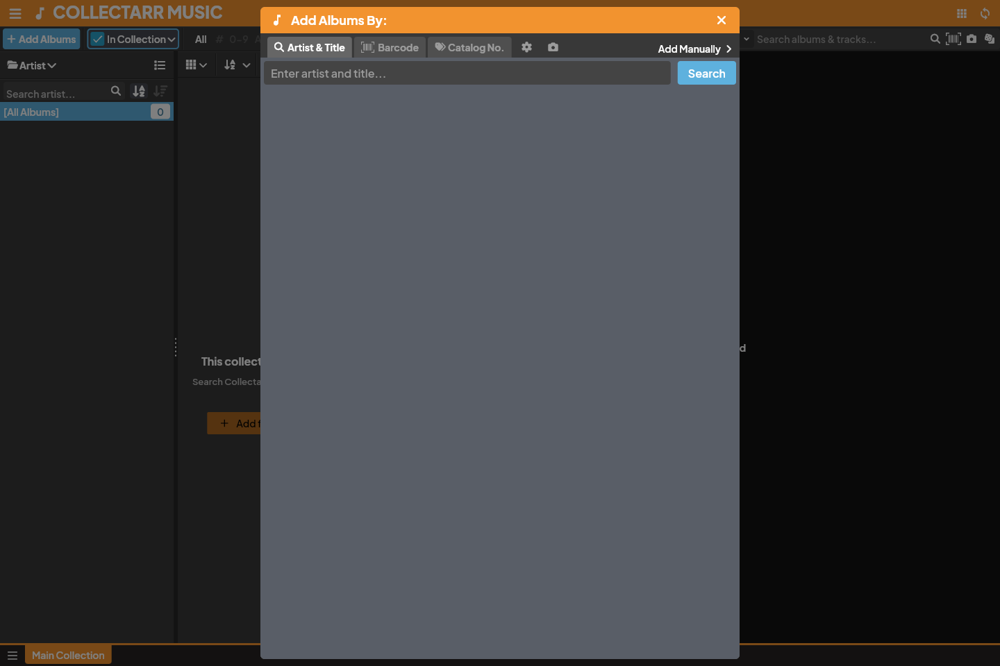
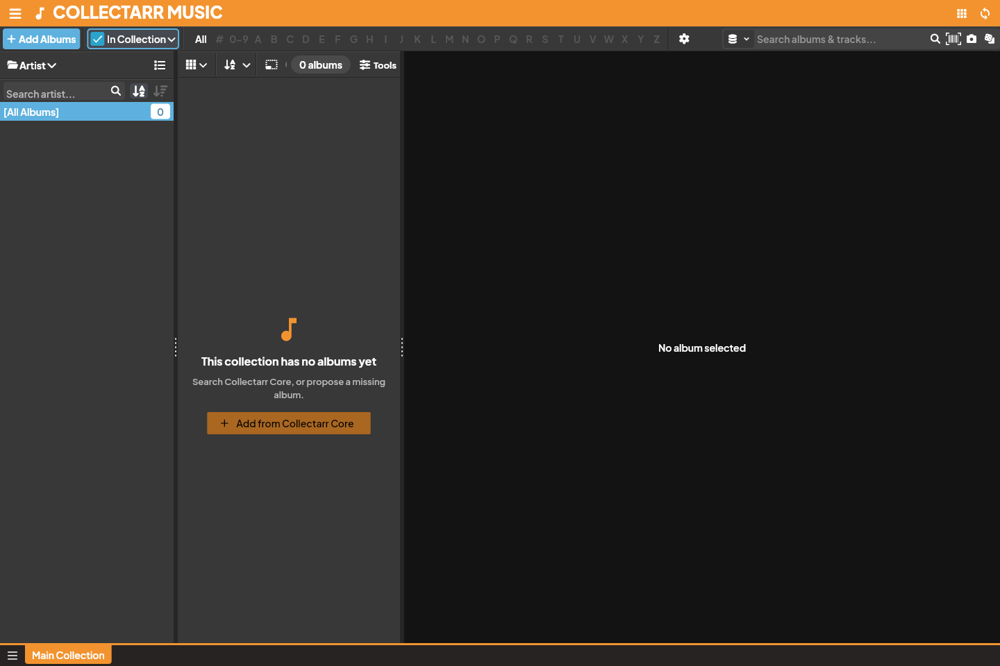
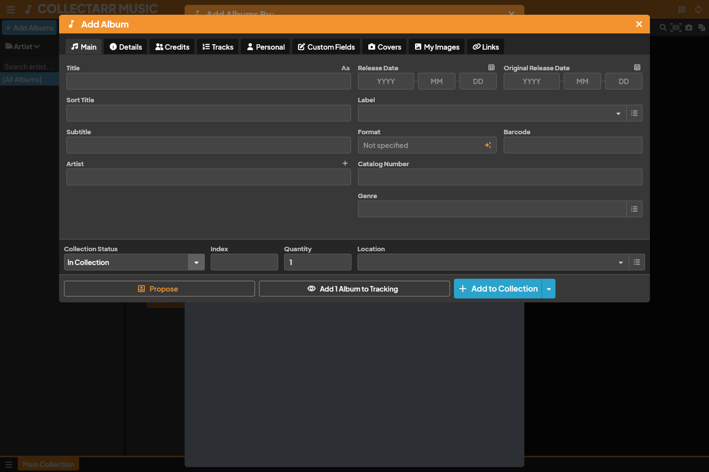

Collectarr provides several ways to catalog your music, whether searching the online **Core** database, scanning physical barcodes, looking up catalog numbers, using camera cover recognition, or typing details manually.

## 1. Adding by Artist and Title (Core Search)

The fastest way to add released albums is through online search:

1. Click the **+ Add Albums** button in the main toolbar (or press `Ctrl+N` / `Cmd+N`).
2. Ensure the **Search** tab is selected.
3. Type the **Artist** name, the **Album Title**, or both into the search box.
   - As you type, matching suggestions appear in the dropdown. You can click a suggestion to jump directly to its results.
4. Press **Enter** or click the search icon. Matching candidate releases appear in the results list.
5. Click an album candidate to inspect it in the **Preview Pane** on the right:
   - Check the track list, disc count, format (e.g. CD vs 12" Vinyl), record label, catalog number, and release year to confirm the exact edition.
6. Select your target **Collection** tab and **Collection Status** (*In Collection* for owned items, *Wish List* for wanted items).
7. Click the **Add to Collection** (or **Add to Wish List**) button at the bottom right.

The album is saved to your local database immediately. You can remain in the Add dialog to add more albums or close it to return to your library.

## 2. Adding by Barcode

Adding by barcode guarantees matching the exact physical packaging and release edition:

1. Open **+ Add Albums** and switch to the **Barcode** tab.
2. Enter or paste the 12-digit (UPC) or 13-digit (EAN) barcode into the input field, then press **Enter**.
3. **Camera Scanning**: Click the **Scan Barcode** icon to open the camera scanner sheet. Point your webcam or mobile camera at the barcode on the back cover or obi strip; Collectarr reads the code instantly upon focus.
4. **Single Match**: If exactly one release matches the barcode, its full details and track list load in the preview pane. Click **Add to Collection**.
5. **Multiple Editions**: If several pressings share the same barcode (for example, a standard edition and a digipak release), the list displays all matching variants. Select your specific edition and add it.
6. **Barcode Not in Core**: If the barcode is unrecognized, Collectarr displays an informational notice and offers to open **Add Manually**, automatically prefilling the scanned barcode so you don't need to retype it.

## 3. Adding by Catalog Number

Many older vinyl pressings, classical records, and promotional releases lack barcodes but feature a clearly printed catalog number on the spine or label:

1. Open **+ Add Albums** and select the **Catalog Nr** tab.
2. Enter the catalog number (e.g. `DEMO-001`, `BST 81535`) and optionally the label or artist.
3. Select the matching entry from the results list and add it to your collection.

## 4. Cover Scan (Photo Recognition)

If you have a record sleeve without visible barcodes or catalog numbers:

1. In the Add dialog, click the **Cover Scan** camera button.
2. Capture a clear photo of the album front cover or upload an existing image.
3. The local cover recognition service extracts artist and title hints and displays a confirmation banner.
4. Review the detected query and click **Search Core** to locate matching editions.

## 5. Adding Albums Manually

For unreleased recordings, independent local releases, bootlegs, or private pressings not found in Core:

1. In the Add dialog toolbar, click **Add Manually**.
2. Work through the tabbed editor:
   - **Main**: Enter the Artist, Title, Sort Title, Release Date (supports year, year-month, or full date), Record Label, Format, Barcode, Catalog Number, and Genres.
   - **Tracks & Discs**: Add one or more discs (CD, Vinyl, Cassette, SACD), set recording date/locations, and add track titles with durations.
   - **Credits**: Add individual musician, songwriter, and producer credits with album- or disc-level scope.
   - **Personal**: Set your purchase date, store, purchase price, condition (e.g. Near Mint, Very Good Plus), storage location, rating, and private notes.
   - **Covers**: Upload front and back artwork from local image files.
   - **Custom Fields**: Populate any user-defined fields you have configured.
3. Click **Save** to create the entry.

## 6. Pre-fill Settings and Defaults

To avoid repetitive data entry when cataloging large batches, configure your defaults:

* Open the gear icon on the Add tab row or navigate to **Settings → Pre-fill Settings**.
* Set default values for new additions, such as **Collection Status** (*In Collection*), **Purchase Date** (*Today*), **Store**, and **Storage Location**.
* Every newly added album automatically inherits these presets.

## 7. Multiple Copies and Duplicates

* **Quantity**: If you own two identical copies in the same condition and location, adjust the **Quantity** field on the album.
* **Independent Entries**: If copies differ in condition, storage location, purchase history, or signatures, add them as separate records. You can also duplicate an existing entry from the library and adjust its personal details.

## 8. Linking and Metadata Proposals

* **Link to Core**: If you created an album manually or imported it from a text file, you can link it later to the online catalog using the **Link** action in the inspector. Linking downloads official track lists, high-resolution artwork, and Core IDs while preserving your personal purchase and condition notes.
* **Proposals**: If you find an error or missing track in a Core entry, submit a catalog proposal. Only public catalog fields are submitted; private notes and personal purchase data remain strictly local. See [Editing](../editing/).
