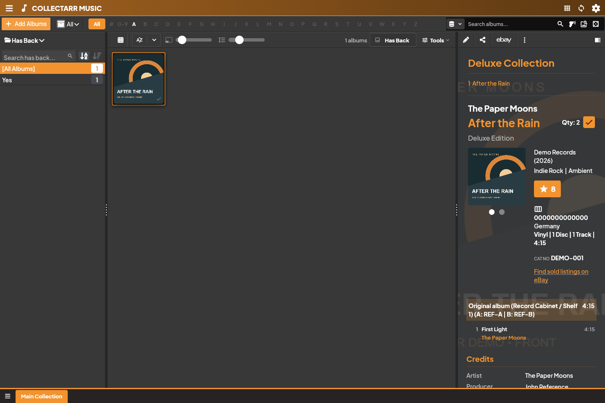

## Views and spacing

The toolbar offers available cover, card, list/table and shelf presentations of the same entries. **Cover Size** adjusts cover presentation. **Item Spacing** changes gaps or row spacing without adding outer padding. Narrow windows can collapse or move controls.

## Search and alphabet

Type into Search. Its dropdown overlays the workspace and offers the choices available for the current search flow. Clear the search to restore the full list. Use a field filter for an exact property rather than broad text matching.

The alphabet bar further restricts the list. Clear the letter when looking for entries outside it. Search, status, collection and folder restrictions can remain active together.

## Group By

Choose a grouping to build folders in the left panel. Select a folder to show matching entries. Alphabetical/count controls order those folders.

A multi-value field can place one entry into several folders. An album with CD and Vinyl discs belongs in both Disc Format folders, once within each folder.

## Selection

Selecting an entry updates the inspector. Selection controls support actions on multiple entries. Check the selected count before bulk editing, removal or exporting. Visible entries and selected entries are not necessarily the same set.
