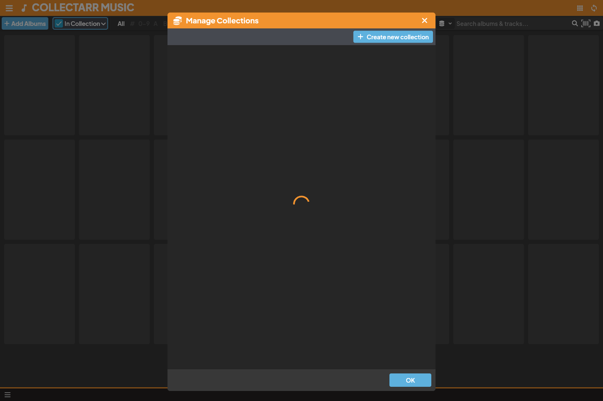

Collectarr provides a clean separation between **Named Collections** (containers for different physical locations or sub-libraries) and **Collection Statuses** (the ownership state of each collectible).

## 1. Named Collections

Tabs along the bottom bar represent distinct collections for the active media kind. You can create separate collections to isolate different physical locations or collections:

* *Main Collection*: Your primary active music library.
* *Vinyl Vault*: High-value vinyl records kept in special protective storage.
* *Living Room*: Frequently played CDs and records next to the turntable.
* *Digital / Bandcamp*: Digital lossless purchases.

Clicking any tab along the bottom switches your entire library view to that collection instantly.

## 2. Managing Collections

To customize your collections:

1. Click the **Manage Collections** button at the bottom-left of the window, or select **Manage Collections** from the main navigation menu.
2. The **Manage Collections** dialog opens:
   * **Add Collection**: Click the **+ Add Collection** button, type a name, and press Enter.
   * **Reorder Tabs**: Click and drag the handle beside any collection row to change its tab position in the bottom bar.
   * **Rename**: Click the edit icon on any row to rename the collection.
   * **Delete**: Click the trash icon to delete a collection.
3. **Safety Protection**:
   * Collectarr enforces that at least one collection must always remain.
   * If you delete a collection that contains albums, Collectarr prompts you to choose another destination collection. All contained albums are safely relocated to the destination collection before the old collection is removed; entries are never silently discarded.

## 3. Collection Status (Ownership Lifecycle)

While a *Collection* defines *where* an item belongs, **Collection Status** defines *how* you own it:

* **In Collection**: You physically own the copy. It appears in collection statistics and valuations.
* **Wish List**: Items you do not own yet but want to buy or track.
* **On Order**: Items you have purchased online or backordered that have not yet arrived.
* **For Sale**: Copies from your collection that you have listed for sale or trade.

### Filtering by Status
* The **Status Dropdown** in the main toolbar allows you to view *In Collection*, *Wish List*, *On Order*, or *All*.
* When a non-default status filter is active, the status pill displays an accent outline to alert you that the view is filtered.

### Changing Status
* **In Inspector**: Select an album, open the status dropdown in the details panel, and pick a new status (e.g. change *Wish List* to *In Collection* upon receiving an album).
* **In Editor**: Open the album editor and adjust the **Collection Status** field on the Main tab.
* **In Batch Edit**: Select multiple albums and use **Edit Multiple** to change their status all at once.

## 4. Comparing Organization Methods

Collectarr offers four distinct ways to organize your albums:

| Method | Type | Best For |
| :--- | :--- | :--- |
| **Named Collections** | Explicit, stable sets | Dividing physical listening rooms, storage units, or formats. |
| **Group By Folders** | Dynamic attribute trees | Browsing albums by Artist, Format, Genre, Decade, or Location. |
| **Collection Status** | Item lifecycle states | Separating owned albums from your wanted Wish List items. |
| **Search & Filters** | Ad-hoc queries | Finding specific barcodes, catalog numbers, or year ranges. |

## 5. Locating Missing Entries

If an album you added does not appear in your library, verify that no restrictive filters are active:
1. Check the **Bottom Tab**: Ensure you are in the correct named collection.
2. Check the **Status Dropdown**: Switch to *All* or *In Collection*.
3. Check the **Alphabet Bar**: Click **All** to clear any active letter filter.
4. Check the **Left Folder Panel**: Select the `[All Albums]` folder at the top of the tree.
5. Check the **Search Field**: Click the `X` button in the search bar to clear any search terms.
