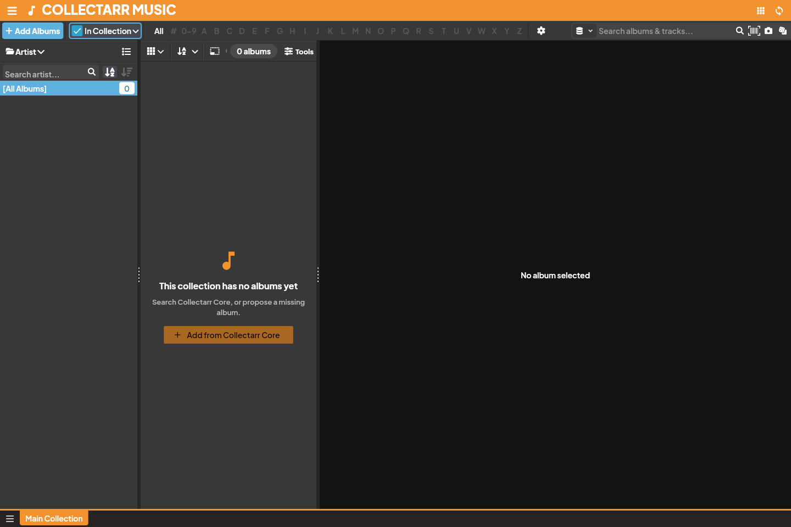

Collectarr offers extensive customization for tabular browsing, multi-level sorting, and automatic name normalization to help you organize your music collection precisely the way you want.

## 1. Choosing Columns (List View)

In **List View**, you can customize exactly which metadata fields appear as table columns:

1. In the toolbar, click the **Columns** icon (or right-click any table header and select **Choose Columns**).
2. The **Column Chooser** dialog opens:
   * **Available Fields**: Browse available catalog and personal fields on the left.
   * **Visible Columns**: Check or uncheck fields to add or remove them from your active table view.
   * **Reordering Columns**: Select a visible field and use the **Move Up** and **Move Down** buttons to change its left-to-right position in the table.
3. Click **Apply** to update your library table.
4. **Resizing Columns**: In the library table, hover your cursor over the vertical divider between any two column headers until the resize handle appears, then drag left or right to set your preferred width.

## 2. Sorting Your Collection

You can sort your collection with simple header clicks or construct sophisticated multi-tiered sort rules:

### Quick Header Sorting (List View)
* Click any column header to sort your library by that field in ascending order (`▲`).
* Click the header again to reverse the order to descending (`▼`).
* In Collectarr, sorted columns display a subtle blue caret and a priority number indicating active sort precedence.

### Multi-Level Sort Dialog
When you want to order albums by artist, then chronologically by year, and finally alphabetically by title:

1. Click the **Sort** button in the main toolbar.
2. In the **Sort** dialog:
   * **First Sort Field**: Select the primary comparison (e.g. *Artist* or *Sort Artist*). Choose *Ascending (A–Z)* or *Descending (Z–A)*.
   * **Second Sort Field**: Select the secondary comparison to break ties (e.g. *Release Year* or *Original Release Year*).
   * **Third Sort Field**: Select the tertiary comparison (e.g. *Title*).
3. Click **Apply Sort**. The library updates immediately according to your criteria.

## 3. Sort Names, Articles, and Natural Number Ordering

Collectarr applies intelligent normalization rules to ensure titles and names sort logically:

### Article Handling (Sort Titles & Sort Names)
* By default, leading definite and indefinite articles (such as *The*, *A*, *An* in English, as well as common international articles like *Le*, *La*, *Les*, *Der*, *Die*, *Das*) are automatically bypassed during alphabetical ordering.
* For example, *The Beatles* is filed under **B**, *The Rolling Stones* under **R**, and *A Tribe Called Quest* under **T**.
* You can manually override any individual album's sort behavior by typing a custom value into the **Sort Title** field in the album editor.

### Contributor Names (Last Name First)
* In pick lists and folder trees, musician and composer names maintain their display formatting (*David Bowie*, *Akira Yamaoka*) while respecting their underlying **Sort Name** (*Bowie, David*, *Yamaoka, Akira*).
* In **Settings → Appearance / Formatting**, you can customize whether names sort by last name or strictly by first letter.

### Natural Number Order
* Numeric values and disk indices sort by numerical magnitude rather than raw text character comparison: *Track 2* sorts before *Track 10*, and *Shelf 2* sorts before *Shelf 12*.

## 4. Music-Specific Values and Summaries

Music collections have unique multi-disc properties that require deliberate sort handling:

* **Format Summary vs. Disc Format**:
  * **Format Summary** describes the complete combination of media across all discs in an edition (e.g. `2xCD + DVD` or `Vinyl + CD`).
  * **Disc Format** contains the distinct physical formats contained within the album. When grouping into folders, use *Disc Format* so that hybrid editions appear in both format categories.
* **Chronological Recording Dates**:
  * **Earliest Disc Recording Date** and **Latest Disc Recording Date** evaluate the actual recorded sessions across all contained discs, providing accurate chronological ordering even for compilation box sets spanning multiple recording eras.
  * Partial dates are ordered safely: a year-only date (e.g. `1973`) is evaluated at the start of that year for earliest comparisons and at the end of that year for latest comparisons.
