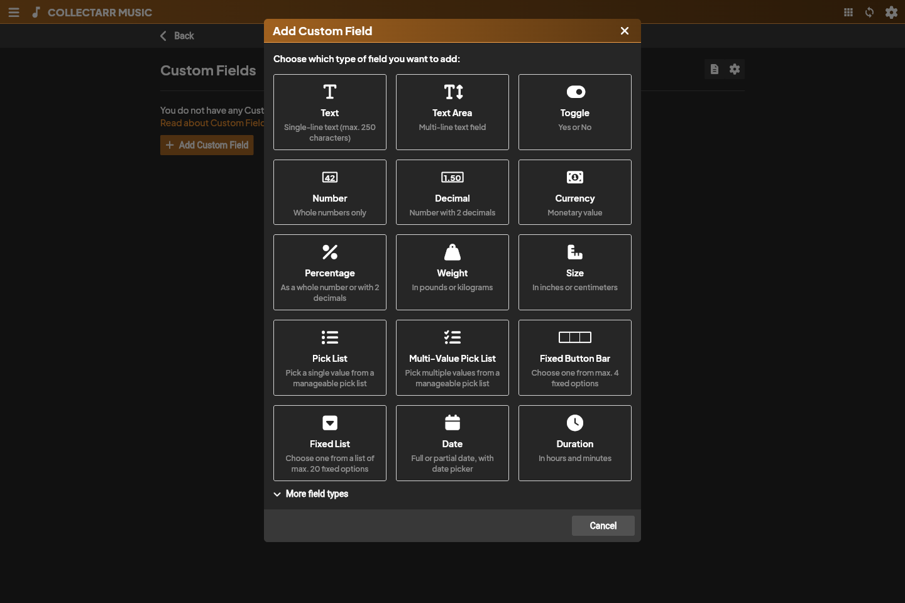

## Create a field

1. Open **Manage Custom Fields**.
2. Choose **Add Custom Field** and select a type.
3. Open **More field types** for Time, URL and Person/contact.
4. Enter its name and the configuration requested by that type.
5. Check the preview and save.
6. Open an entry's **Custom Fields** tab to fill in the value.

The preview shows an example control; it never saves a value to an entry.

## Types

| Type | Purpose | Configuration |
| --- | --- | --- |
| Text | Short text | Up to 250 characters |
| Text Area | Longer notes | Multiline |
| Toggle | Yes/no | Two-state control |
| Number | Whole numbers | Integer storage |
| Decimal | Decimal values | Decimal storage |
| Currency | Amount | Number/Decimal and display currency |
| Percentage | Percentage | Number/Decimal |
| Weight | Weight | Number/Decimal and g, kg, lb or oz |
| Size | Dimension | Number/Decimal and cm, in or mm |
| Pick List | One reusable value | Editable list |
| Multi-Value Pick List | Several values | Control and display configuration |
| Fixed Button Bar | Small choice set | Up to four choices |
| Fixed List | Fixed choices | Up to twenty choices |
| Date | Complete/partial date | Date control |
| Duration | Elapsed time | Hours/minutes; hours may exceed 24 |
| Time | Time of day | Time control |
| URL | Web address | URL control |
| Person / contact | Contact value | Person control |

Choose storage for Currency, Percentage, Weight and Size before evaluating the preview. Weight/Size also require a unit. Display currency does not perform currency conversion.

## Multi-value controls

Choose Check List, Name List, Person List or Tag List for the desired interaction. Display separators/list presentation affect the inspector; the values remain separate.

## Fixed choices

Add choices as separate rows and reorder them. Empty/duplicate choices are rejected. Existing fixed choices and storage type are locked after creation, so review them before saving.

## Maintenance and tab settings

Edit changes the name and allowed configuration. Drag rows to reorder fields. Check whether you need the values before deleting a definition.

**Custom Fields settings** changes the tab name and visibility. Inspect the definition's offered scope to distinguish kind-specific and shared fields.
