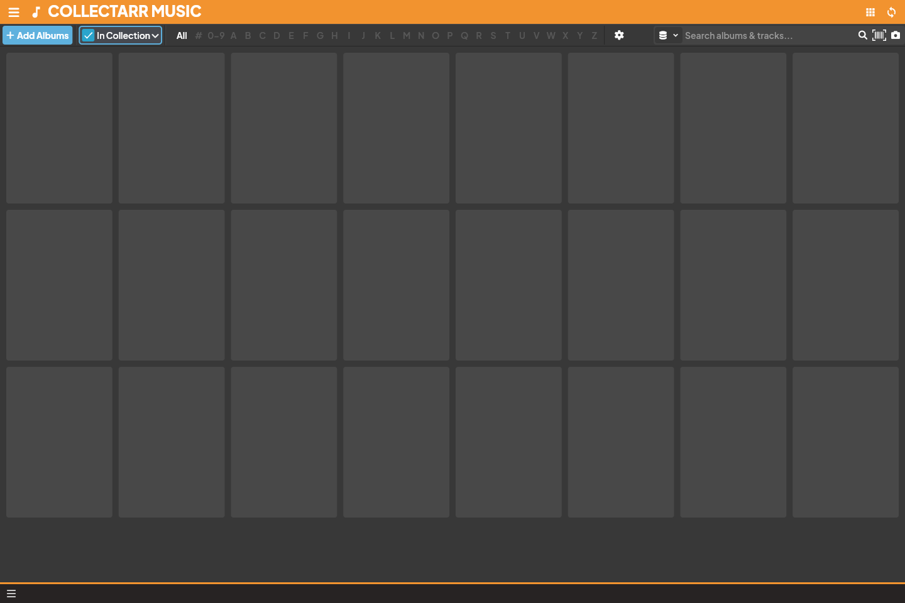

Collectarr includes dedicated tools to locate accidental duplicate purchases and maintain clean, sequential inventory index numbers across your collection.

## 1. Finding Duplicates

When cataloging hundreds or thousands of albums, duplicates can occur through multiple imports, accidental re-additions, or forgotten purchases.

To identify duplicate albums:

1. Open the main navigation menu and select **Find Duplicates** (under *Tools*).
2. Choose your duplicate detection criteria:
   * **Same Barcode**: Locates entries sharing identical UPC or EAN barcodes (the strongest indicator of accidental duplicates).
   * **Same Artist and Title**: Locates entries with matching names, even if cataloged with slightly different editions.
   * **Same Catalog Number**: Locates entries sharing the same record label catalog code (e.g. `DEMO-001`).
3. The comparison screen groups suspected duplicates together, displaying:
   * Artist, Album Title, and Subtitle
   * Physical Format and Track Count
   * Date Added and Collection Status
   * Storage Location, Condition, and Personal Notes
4. **Resolving Candidates**:
   * **Intentional Duplicates**: You may deliberately own two copies of the same album (e.g. a sealed archival copy and a daily listening copy, or a vinyl pressing and a portable CD). In this case, keep both and record their distinct conditions or locations.
   * **Accidental Duplicate**: Click **Remove** on the redundant entry to safely delete it.
   * **Multi-Disc Parts**: If the duplicates are actually Disc 1 and Disc 2 of a multi-disc set entered separately, return to the library and use **Merge Albums**. See [Editing](../editing/).

## 2. Re-Assigning Index Numbers

The **Index** is your personal physical inventory numbering system—often written on protective outer sleeve stickers or divider cards in your physical shelving units. It is entirely separate from catalog numbers, barcodes, or disc track numbers.

Over time, selling albums or reorganizing shelves can leave gaps in your numbering sequence (e.g. 1, 2, 5, 8, 14...).

To renumber your collection cleanly:

1. Open the main menu, expand **Maintenance**, and select **Re-Assign Index Values**.
2. Configure the re-indexing scope and rules:
   * **Scope**: Choose whether to re-index *All Collections*, only the *Active Collection*, or your currently *Selected Entries*.
   * **Sort Order**: Select the sequence applied before numbering (e.g. sort alphabetically by *Artist then Year*, or chronologically by *Date Added*).
   * **Starting Index**: Enter your starting number (typically `1`, or an offset such as `1001` for a second listening room).
3. Review the preview indicating how many albums will be updated and the resulting index range.
4. Click **Apply Re-indexing**. Collectarr assigns sequential index numbers across all matching entries.

## 3. Best Practices Before Maintenance

> [!IMPORTANT]
> Always perform a local database backup before executing bulk re-indexing or batch duplicate deletions. If you ever need to restore previous index numbers or accidentally deleted entries, you can revert instantly from **Settings → Data → Restore**. See [Backup and Sync](../backup-sync/).
