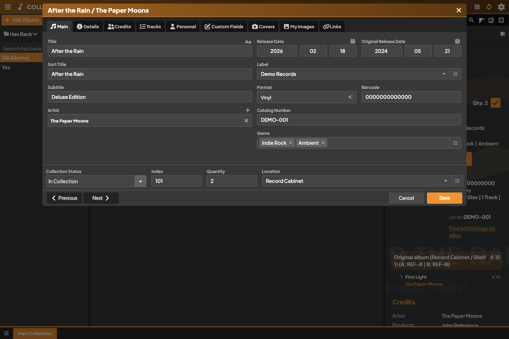

The Collectarr editor allows you to refine catalog metadata, manage multi-disc track lists, credit contributing musicians, and record comprehensive personal collection details.

## 1. Opening the Editor

To edit an album, use any of the following methods:

* Select an album in your library and click the **Edit** button (pencil icon) in the right-hand Inspector toolbar.
* Double-click any row or card in the library.
* In Cards, Covers, or Shelves view, hover your mouse over an album to reveal the quick **Edit** button.
* Press `Enter` or `Ctrl+E` / `Cmd+E` when an item is selected.

## 2. Catalog Metadata vs. Personal Data

Collectarr maintains a clean separation between shared catalog information (what the item is) and your personal inventory records (information about your specific physical copy):

| Catalog Metadata (Shared) | Personal Inventory Data (Private) |
| :--- | :--- |
| Album Title, Sort Title, Subtitle | Collection Status (*In Collection*, *Wish List*, etc.) |
| Main Artist and Credited Artists | Personal Index Number and Quantity |
| Release Date and Original Release Date | Storage Location (e.g. *Record Cabinet / Shelf 1*) |
| Record Label, Catalog Number, Barcode | Condition (Media & Sleeve grading) |
| Packaging (Jewel Case, Digipak, Gatefold) | Purchase Date, Store, and Purchase Price |
| Discs, Track Titles, Positions and Durations | Current Estimated Value |
| Scoped Contributor Credits & Roles | Personal Rating (1–10 stars) |
| Official Front & Back Cover Artwork | Private Notes and Listening History |

> [!NOTE]
> When you propose corrections to the shared online Core catalog, only public catalog metadata is submitted. Your private purchase prices, condition notes, personal images, and storage locations are never sent.

## 3. Editor Tabs Overview

The editor organizes metadata into focused tabs:

* **Main**: Primary identifying fields including Title, Sort Title (for alphabetical ordering), Artist, Format, Record Label, Catalog Number, Barcode, Release Date (supports year, year-month, or full date), and primary personal fields (Status, Location, Index).
* **Details**: Extended release properties such as Country of release, Packaging type, Box Set association, and original sound formats.
* **Credits**: Contributor information. Add musicians, producers, sound engineers, and arrangers. You can pick roles from your manageable vocabulary and specify the credit scope (**Applies to**: *Entire Album*, or a specific *Disc*). See [Music credits](../kinds/music/).
* **Tracks**: Manage individual discs and track lists. Click **Add Disc** on the right of the tab strip to create multi-disc sets. Drag disc tabs to reorder them. Edit track titles, track artists (for compilations), and durations (`m:ss`).
* **Personal**: In-depth copy tracking. Record the purchase date, store name, purchase price, current valuation, media condition, sleeve condition, personal rating, and private free-form notes.
* **Custom Fields**: Populate any user-defined fields you have configured for your library. See [Custom Fields](../custom-fields/).
* **Covers**: Manage high-resolution front and back cover images. Use **Find Online** to search for replacement artwork or upload local image files.
* **My Images**: Store personal photos of your physical copy, such as vinyl matrix runout etchings, obi strips, booklet inserts, or artist signatures.
* **Links**: External web URLs (e.g. Bandcamp, Discogs, Official Artist Site, Wikipedia).

## 4. Saving and Navigating

* Click **Save** (highlighted in the kind's accent color) or press `Ctrl+S` / `Cmd+S` to commit changes to your local database.
* Click **Cancel** or press `Escape` to close the editor. If you made unsaved changes, Collectarr asks for confirmation before discarding edits.
* Use the **Previous** (`<`) and **Next** (`>`) buttons at the bottom left to page through albums in your current library view without having to close and reopen the editor.

## 5. Batch Editing (Multi-Edit)

When you need to update a property across many albums simultaneously (for example, moving 20 albums to a new storage location, setting a common genre, or changing their collection status):

1. In the library, select the target albums:
   * Hold `Ctrl` (`Cmd` on macOS) to select individual albums.
   * Hold `Shift` to select a range of albums.
   * Click the **Select All** or selection toggle in the toolbar.
2. In the selection toolbar or right-click context menu, choose **Edit Multiple**.
3. In the Batch Edit dialog, check the checkbox next to each field you want to modify.
4. Enter the new value (e.g. select a new **Storage Location** or **Genre**).
5. Unchecked fields remain completely untouched on all selected items.
6. Check the selected item count at the bottom of the dialog, then click **Apply Changes**.

## 6. Merging Albums into a Multi-Disc Set

If you previously added or imported a multi-disc release as separate single-album entries (for example, *Disc 1* and *Disc 2* listed as two individual albums in your library):

1. Select the separate album entries in your library list.
2. Click **Tools → Merge Albums** in the toolbar.
3. In the Merge Albums dialog:
   * Select which entry represents the primary metadata (Title, Artist, Label, Release Year, and Cover Art).
   * Arrange the order of the discs (e.g. assign Entry A as Disc 1 and Entry B as Disc 2).
4. Review the merged track list preview.
5. Click **Merge**. Collectarr consolidates all discs and tracks into a single unified album entry and cleanly removes the duplicate single entries.

## 7. Linking and Updating from Core

* **Link to Core**: Associates an unlinked local entry (such as one entered manually or imported via CSV) with the canonical Core catalog. Collectarr searches Core, displays matching editions, and attaches the Core reference.
* **Update from Core**: If track lists, credits, or artwork in the central database have been corrected or enhanced since you added the album, open **Tools → Update from Core** to refresh catalog metadata while leaving your personal purchase, condition, and location fields intact.
