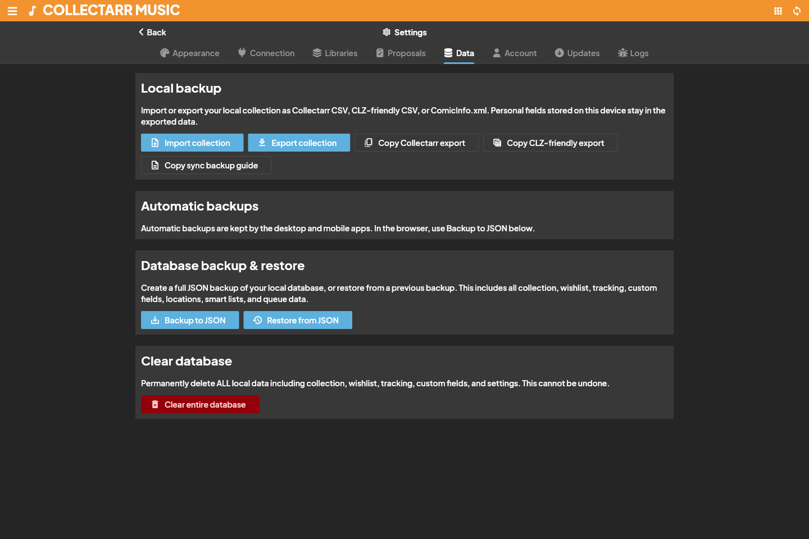

Collectarr supports robust data exchange, enabling you to bring your existing collections from spreadsheets or other catalog software, export custom reports, and generate printable PDF documents.

## Importing Data into Collectarr

Open the main drawer menu and navigate to **Maintenance** → **Import Data** (or choose **Import** from the library toolbar **Tools** menu).

### 1. Supported Import Formats

- **CSV / TSV / Delimited Text**: Import tabular files from spreadsheets (Excel, Google Sheets, LibreOffice Calc) or other collection apps.
- **CLZ XML**: Collectarr includes native parsing for CLZ Music XML export files, preserving titles, artists, labels, catalog numbers, multi-disc track lists, and personal notes.
- **JSON / Database Archives**: For complete backups and restoring Collectarr data, see [Backup and sync](../backup-sync/).

### 2. Step-by-Step Import Workflow

1. **Select File and Format**:
   - Choose your file (`.csv`, `.tsv`, `.txt`, or `.xml`).
   - If importing text, select the appropriate delimiter (Comma `,`, Tab `\t`, or Semicolon `;`) and verify text encoding (UTF-8 recommended).
2. **Column / Field Mapping**:
   - Collectarr displays each column found in your file alongside a target field selector.
   - Map each source column to the corresponding Collectarr field (e.g. `Album` → **Title**, `Band` → **Artist**, `Cat#` → **Catalog Number**).
   - Any column left set to *(Ignore)* will be safely skipped.
3. **Inspect the Preview Table**:
   - Review the first several rows parsed from your file to ensure accented characters, dates, and numbers align correctly.
4. **Choose Destination Collection**:
   - Select the target collection (e.g. *Main Collection*) and default collection status (*In Collection* or *Wish List*).
5. **Execute Import**:
   - Click **Start Import**. Collectarr creates records and automatically populates manageable pick lists (Artists, Labels, Genres) with new entries found in the file.

> [!TIP]
> Before importing an entire library of thousands of rows, test with a sample file containing 2–5 rows. This confirms date formats (e.g. `YYYY-MM-DD` vs `MM/DD/YYYY`) and multi-value delimiters parse as intended.

---

## Exporting to CSV / TXT

You can export flat text files for external data analysis, sharing with friends, or custom spreadsheet tracking.

1. In the library toolbar, click **Tools** → **Export to CSV / TXT** (or select specific albums and click **Export to CSV / TXT** in the selection actions band).
2. **Configure Scope**:
   - **All items**: Exports the entire active library.
   - **Filtered view**: Exports only items currently displayed by active searches or folders.
   - **Selected items**: Exports only explicitly checked records.
3. **Choose Export Columns**:
   - Select the fields to include in the output.
   - *Music Format Note*: Choose **Disc Formats** for individual media types (e.g., `Vinyl`, `CD`) or **Format Summary** for combined physical packaging (e.g., `2xVinyl + CD`).
4. **Delimiter and Encoding**:
   - Select **Comma (CSV)**, **Tab (TSV)**, or **Semicolon**.
   - Check **Include header row** to keep column names as the first line.
5. Click **Export** and save the file to your local computer.

> [!NOTE]
> CSV and text files are flat representations. They do not store cached binary artwork, custom field schema definitions, or relational track linkages. For complete, restorable snapshots, use **Backup Database**.

---

## XML Integration Export

For developers and advanced catalogers, Collectarr provides hierarchical **Export to XML**:
- Open **Tools** → **Export to XML** (or via the batch selection menu).
- Produces a structured XML document containing full album hierarchies, disc structures, track timings, and contributor credits.

---

## Print to PDF

Collectarr features a built-in PDF generator for printing physical catalog binders, insurance records, or inventory checklists:

1. Click **Tools** → **Print to PDF** (or select records and choose **Print to PDF** from the batch menu).
2. **Select Layout Style**:
   - **List Report**: Compact, dense rows with customizable columns, optimal for high-density physical inventory binders.
   - **Cards Report**: Visual blocks featuring front cover thumbnails alongside essential catalog details.
3. **Page Configuration**:
   - Choose paper size (**A4** or **US Letter**), page orientation (Portrait or Landscape), and margin widths.
4. **Preview and Save**:
   - Inspect the real-time PDF print preview directly in the application window.
   - Click **Save PDF** to write the document or **Print** to send directly to your connected printer.

