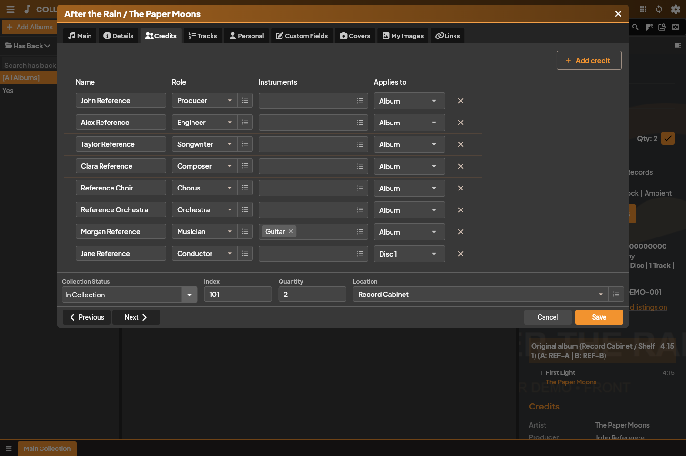

Collectarr Music is tailored specifically to the physical realities and cataloging needs of music collectors, audiophiles, and crate diggers.

## 1. Album and Disc Architecture

In Collectarr, an **Album** represents a concrete, physical or digital edition:
- **Multi-Disc Container**: An album is not just a flat list of songs; it contains one or more physical **Discs** (or sides/volumes), and each disc contains its own **Tracks**.
- **Root Album Attributes**: Shared edition metadata includes Title, Subtitle, Sort Title, Release Date, Original Release Date, Primary Artist Attribution, Record Label, Country, Barcode, Catalog Number, Packaging Type (Digipak, Gatefold, Jewel Case), Box Set name, and Cover Artwork.

---

## 2. Discs, Formats, and Technical Metadata

Each disc inside an album is cataloged with its own distinct physical and technical specifications:

### Format Families
Every disc format belongs to a defined **Format Family**:
- **Vinyl**: `12" LP`, `7" Single`, `10" EP`, `12" Single`, `Flexi-disc`
- **Optical Disc**: `CD`, `SACD`, `Hybrid SACD`, `DVD-Audio`, `Blu-ray Audio`, `DualDisc`
- **Tape**: `Cassette`, `8-Track`, `Reel-to-Reel`
- **Digital**: `FLAC`, `ALAC`, `DSD`, `WAV`, `MP3`, `AAC`
- **Other**: Custom formats mapped to a supported family

> [!NOTE]
> Format summaries in library views are automatically generated from disc contents. An edition containing one vinyl disc and one bonus CD will report a format summary of `Vinyl + CD`, and will cleanly appear in both the **Vinyl** folder and the **CD** folder.

### Disc-Level Technical Specs
In the **Tracks** tab of the album editor, you can customize per-disc attributes:
- **Disc Type**: `Studio`, `Live`, or `Compilation` (allowing box sets to mix studio albums with live concert discs).
- **SPARS Code**: Three-letter audio recording/mastering code (`DDD`, `ADD`, `AAD`).
- **Recording Dates and Locations**: Document when and where individual sessions were recorded.
- **Matrix / Runout Grooves**: Record vinyl dead-wax stampers, pressing plant indicators, and lacquer cut signatures.

---

## 3. Track Lists and Durations

- **Track Indexing**: Tracks are numbered sequentially within each disc (e.g., Disc 1: Tracks 1–10; Disc 2: Tracks 1–8). For vinyl, track positions can use traditional side letters (e.g., `A1`, `A2`, `B1`, `B2`).
- **Durations**: Track lengths are entered as `MM:SS` or total seconds. Collectarr automatically aggregates track lengths into disc playing times and the overall album duration.
- **Bonus Tracks**: Flag outtakes, demos, or reissue bonus tracks.

---

## 4. Contributor Credits and Scope

Collectarr provides a modern, flexible contributor credit system in the **Credits** tab:

### Artist Attribution vs. Contributor Credits
- **Primary Artist Credits**: Located on the **Main** tab. Defines headlining artist attributions, including multi-artist join phrases (e.g., *Artist A* `feat.` *Artist B* `&` *Artist C*).
- **Role-Based Credits**: Located on the **Credits** tab. Catalogs guest musicians, session performers, instrument players, producers, audio engineers, mastering specialists, and arrangers.

### Scoped Credit Application
Every credit entry specifies an **Applies to** scope:
- **Entire Album**: The contributor worked across the entire release (e.g. Mastered by *Bob Ludwig*).
- **Specific Disc**: The contributor played on a specific disc only (e.g. Guest orchestra on *Disc 2 (Live)*).
- **Specific Track**: A guest vocalist or soloist appearing on an individual track.

---

## 5. Personal Information and Condition Grading

Personal collecting details are stored securely in your local database:
- **Goldmine Condition Grading**: Grade media and sleeves independently using industry-standard Goldmine tiers (*Mint*, *Near Mint*, *Very Good Plus (VG+)*, *Very Good (VG)*, *Good*, *Poor*).
- **Physical Location**: Assign albums to specific record bins, shelves, or storage crates.
- **Acquisition Details**: Track purchase dates, acquisition prices, store names, and current replacement values.

