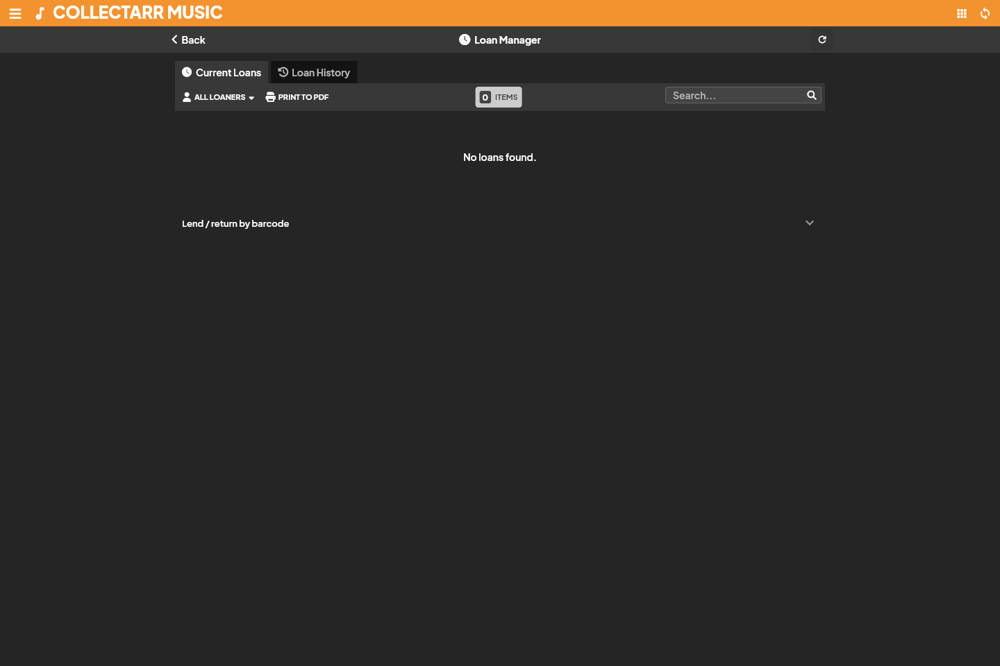
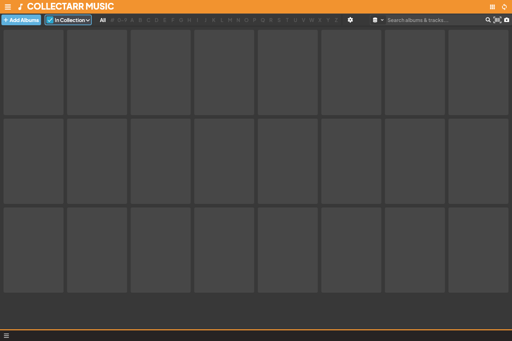

## Loan Manager

The **Loan Manager** provides central tracking for items lent to friends, family, or colleagues. It ensures you always know where copies of your collection are located without creating phantom duplicates or altering catalog records.

### Lending an item

1. **Select the album** in your library.
2. In the secondary toolbar or selection bar, click the **More actions** button (`...`) and choose **Loan**, or open **Loan Manager** from the main drawer menu.
3. In the loan dialog:
   - **Borrower**: Choose an existing contact or enter a new name.
   - **Loan Date**: Defaults to today; adjust if the loan occurred earlier.
   - **Due Date**: Optional expected return date. Items past this date appear highlighted in overdue views.
   - **Notes**: Record any specific conditions or contact details.
4. Click **Record Loan**. The album displays a loan badge in your library views.

### Returning and loan history

When an item is returned:
1. Open **Loan Manager** from the drawer menu.
2. Locate the active loan under the **Outstanding** tab.
3. Click **Return** on the loan record.
4. Confirm the return date and save.

> [!NOTE]
> Always mark the loan as returned rather than deleting the loan record. Marking as returned preserves the lending history for that specific copy, allowing you to see past borrowers and lending frequency.

### Overdue loans and filters

The Loan Manager toolbar offers quick filters:
- **Outstanding**: All items currently checked out.
- **Overdue**: Items whose due date has passed without a return recorded.
- **Returned**: Historical log of completed loans.
- **Borrower filter**: View all active and past items borrowed by a specific contact.

---

## Statistics Dashboard

Open **Statistics** from the main drawer menu or the library toolbar **Tools** dropdown to inspect high-level metrics and distributions across your collection.

### Scope and filters

Before interpreting counts and charts, verify the active scope displayed at the top of the dashboard:
- **Collection Scope**: Toggle between the active named collection (e.g., *Main Collection*) or aggregate across all collections.
- **Status Scope**: Choose to analyze items **In Collection**, **Wish List**, **For Sale**, or **All Statuses**.
- Filters applied on the library workspace (such as active search queries or folder selections) can be inherited or cleared.

### Overview metrics

The top summary cards display key collection totals:
- **Total Albums & Discs**: Distinct album entries and total physical disc count (accounting for multi-disc editions).
- **Track Count & Duration**: Total indexed audio tracks and aggregated running time across all cataloged discs.
- **Completed Plays**: Listening sessions logged in your personal history.
- **Estimated / Purchase Value**: Sum of stored purchase prices and current values.

> [!IMPORTANT]
> Monetary totals represent stored user-entered values in your configured primary currency. Missing prices do not establish zero value, and statistics do not constitute a formal appraisal or real-time market quote.

### Breakdown charts

Collectarr generates interactive bar charts and breakdown distributions:
- **Format Breakdown**: Distribution of Vinyl (LP, 12", 7"), CD, SACD, Cassette, and Digital releases.
- **Decades & Eras**: Albums grouped by release year and decade (e.g., 1960s, 1970s, 1980s).
- **Top Artists & Labels**: Most represented recording artists and imprint labels in your library.
- **Genres & Styles**: Musical classification distribution.
- **Condition & Grading**: Physical condition grades across media and sleeves.

---

## Listening activity and progress

Collectarr allows recording listening history directly from the album details panel or the **Tracking** tab in the album editor:
- **Play Count**: Track how many times an album has been played.
- **Last Played**: Date of your most recent session.
- **Calendar History**: Personal listening dates tracked chronologically for review and habits analysis.

