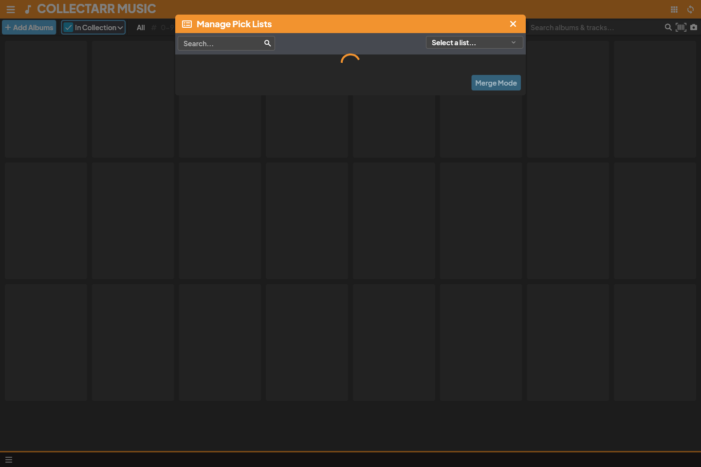

Pick lists maintain controlled, reusable vocabularies across your collection—including **Artists**, **Record Labels**, **Genres**, **Storage Locations**, **Formats**, **Contributor Roles**, and **Instruments**.

## 1. Why Vocabulary Consistency Matters

When browsing your collection by folder or filtering by genre, subtle inconsistencies in naming will split your albums across separate groups:
* If five albums are tagged with `Pink Floyd` and one is accidentally entered as `Pink Floyd ` (with a trailing space), Collectarr will create two distinct artist folders.
* Similarly, `Demo Records` and `Demo Records Ltd.` would be filed as two separate labels.

Collectarr's **Manage Pick Lists** tool provides centralized maintenance to keep your vocabularies unified and clean.

## 2. The Pick List Manager

To inspect and manage your vocabularies:

1. Open the main navigation menu and select **Manage Pick Lists** (or click the manage icon next to any pick list field in the editor).
2. Use the **Select a list...** dropdown at the top right to choose the vocabulary you want to maintain:
   * *Artists / Credited Artists*
   * *Record Labels*
   * *Genres*
   * *Storage Locations*
   * *Formats*
   * *Roles & Instruments*
3. The table displays every unique value currently in your database, alongside its:
   * **Name**: The display name shown in your library and inspector.
   * **Sort Name**: The normalized name used for alphabetical ordering (e.g. `Bowie, David`).
   * **Item Count**: The total number of albums, tracks, or credits currently using that value.

## 3. Maintenance Actions: Add, Rename, Merge, and Delete

The Pick List Manager provides four essential operations:

### Adding New Values
* Click **Add Value** to define an entry in advance. You can specify both its display name and custom sort name.

### Renaming Values Across Your Library
* If you want to correct a typo or standardize casing (e.g. changing `Demo recs` to `Demo Records`):
  1. Click the edit icon on the target row.
  2. Update the name.
  3. Click **Save**. Collectarr updates every single album and track referencing that value throughout your entire database in a single atomic transaction.

### Merging Duplicate Values (Merge Mode)
When albums have been imported or entered with slight name variations, use **Merge Mode** to combine them:

1. In the Pick List Manager toolbar, click **Merge Mode**.
2. Select the duplicate values you want to consolidate (for example, check both `The Paper Moons` and `Paper Moons, The`).
3. Select which of the two spellings should be retained as the canonical target name.
4. Click **Merge**. Collectarr reassigns all albums and tracks to the chosen target name and permanently deletes the duplicate entry from your vocabulary.

### Deleting Unused Values
* Values with a count of `0` (no longer associated with any albums or tracks) can be safely deleted to keep your dropdown choices concise. Click the trash icon to remove an unused value.

## 4. Pick Lists vs. Custom Field Fixed Choices

* **Pick Lists**: Dynamic vocabularies shared across catalog and personal fields. They automatically grow as you add albums and can be maintained and merged at any time.
* **Fixed Lists**: Configured strictly when defining a custom field. They restrict input to an explicit set of choices (e.g. *Audio Quality: Flac / MP3 / Wav*) that does not change dynamically with new entries. See [Custom fields](../custom-fields/).
