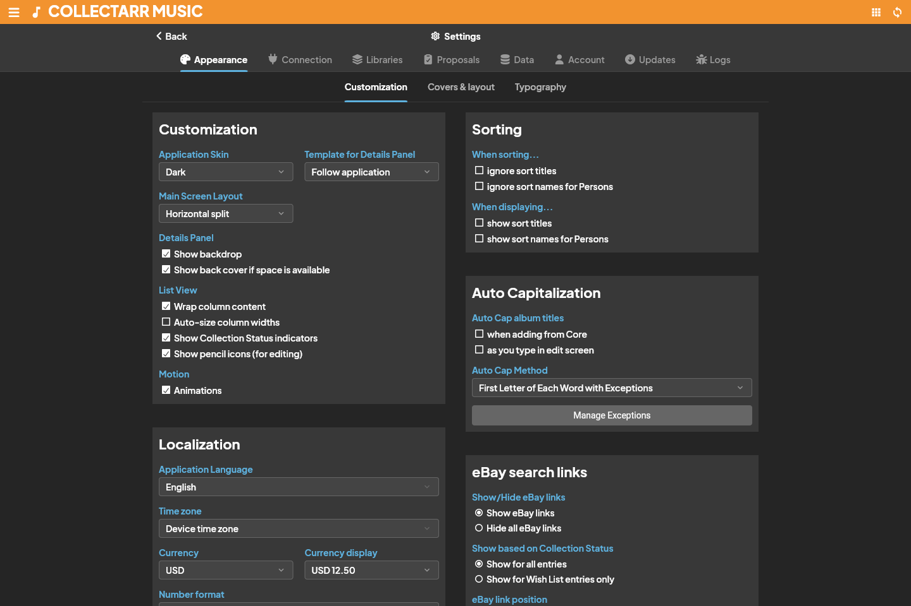
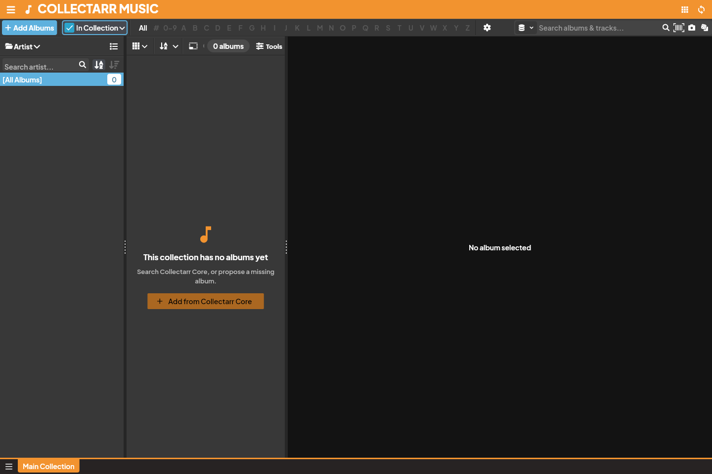

Collectarr offers rich customization options to tailor the interface, theme, data defaults, and keyboard workflows to your personal collecting preferences.

Open **Settings** from the main drawer menu (or click the gear icon in the toolbar).

## Settings Sections Overview

| Section | Description and Primary Controls |
| :--- | :--- |
| **Appearance** | Theme (Dark/Light), accent colors, cover styling, typography, localization, and date/currency formats |
| **Pre-fill Settings** | Automatic default values (Location, Condition, Tags, Store) for newly added albums |
| **Data** | Full database backup (JSON), database restoration, cover cache maintenance, and vacuum |
| **Connection** | Collectarr Core metadata server, personal cloud synchronization pairing, and sync history |
| **Libraries** | Collection defaults and enabled media categories |
| **Proposals** | Status and history of submitted metadata contributions and revisions sent to Core |
| **Account** | User profile credentials and authentication tokens |
| **Logs** | Diagnostic activity logs, sync event history, and error reports |

---

## Appearance and Layout

The **Appearance** tab controls how Collectarr looks and behaves across all views and panels.

### 1. Theme and Customization
- **Theme Mode**: Switch between **Dark Mode**, **Light Mode**, or follow **System Default**.
- **Accent Color**: Personalize the highlight accent used across buttons, tabs, selection bands, and active icons.
- **Status Indicators**: Show or hide color-coded collection status badges (In Collection, Wish List, For Sale) on covers and list rows.
- **Action Buttons**: Display inline edit and more-options buttons when hovering over albums.

### 2. Covers & Layout
- **Cover Presentation**: Choose between standard shadowed covers or enable **Flat Covers** for a modern, flush look.
- **Card Cover Width**: Fine-tune the width of cover artwork in Card View between `60px` (ultra-compact) and `120px` (large thumbnail).
- **Inspector Back Cover**: Toggle whether the album details panel shows both front and back covers side-by-side.
- **eBay Integration**: Show or hide direct links to eBay sold listings next to catalog numbers and cover images.

### 3. Typography & Localization
- **Primary Currency**: Set your preferred currency symbol (`$`, `€`, `£`, `¥`, `lei`, etc.) for purchase tracking and valuation totals.
- **Date Format**: Choose your preferred regional date format (`YYYY-MM-DD`, `DD/MM/YYYY`, or `MM/DD/YYYY`).
- **Articles Ignore List**: Customize the list of leading grammatical articles (`The`, `A`, `An`, `Le`, `La`, `Das`, `Der`) bypassed during alphabetical sorting.

---

## Pre-fill Settings

Save time when cataloging new acquisitions by configuring **Pre-fill Settings** (accessible via drawer menu or **Settings**):

- **Default Storage Location**: Automatically assign newly added items to your main shelf or physical rack.
- **Default Condition**: Pre-select your typical acquisition grade (e.g., *Near Mint* or *Mint*).
- **Default Tags**: Automatically attach common tags (such as `Vinyl 2026` or `Record Store Day`).
- **Default Purchase Store**: Pre-fill your favorite local record store or online seller.
- **Always Show Prompt**: Option to review pre-fill values before each album is committed.

> [!NOTE]
> Pre-fill settings apply only to future additions. Changing pre-fill defaults does not alter records already in your collection.

---

## Keyboard Shortcuts Reference

Collectarr is optimized for rapid desktop keyboard navigation:

| Shortcut | Context | Action |
| :--- | :--- | :--- |
| `Ctrl + F` / `Cmd + F` | Library | Focus the search box |
| `Ctrl + A` / `Cmd + A` | Library | Select all visible albums |
| `Escape` | Global | Clear search, cancel multi-selection, or close dialogs |
| `Ctrl + S` / `Cmd + S` | Editor | Save changes and close the editor |
| `Delete` / `Backspace` | Library | Delete the selected album(s) (with confirmation) |
| `<` / `>` (Left / Right) | Editor | Navigate to previous or next album without closing editor |
| `F5` / `Ctrl + R` | Global | Refresh current view and reload catalog cache |
| `Ctrl + E` / `Cmd + E` | Library | Open editor for the currently selected album |

