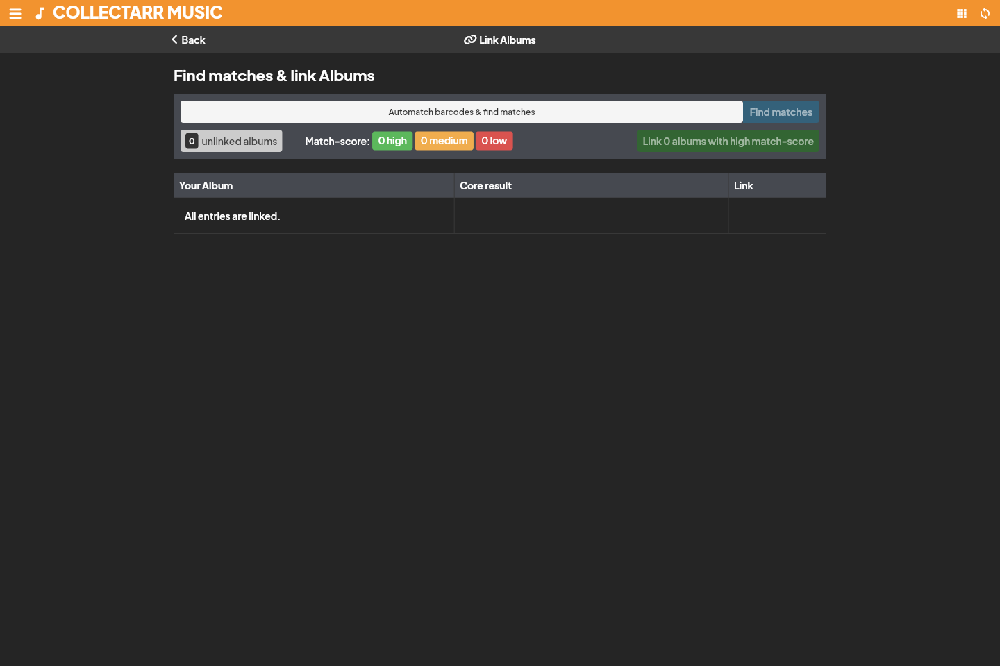

The **Transfer Field Data** tool allows you to copy or move data between compatible metadata fields across single entries, filtered subsets, or your entire collection. It is particularly useful when reorganizing your cataloging standards (for instance, migrating general notes into a dedicated custom field or copying catalog numbers into location notes).

## Opening Transfer Field Data

You can launch the tool from multiple locations:
- **Main Drawer Menu**: Select **Maintenance** → **Transfer Field Data**.
- **Library Toolbar**: Click the **Tools** dropdown and choose **Transfer Field Data**.
- **Batch Selection**: Select one or more albums, click the **More actions** button (`...`) in the selection toolbar, and choose **Transfer Field Data** to automatically scope the operation to the selected records.

---

## Configuring the operation

1. **Select the Target Scope**:
   - **All items**: Applies across the entire current library.
   - **Filtered view**: Applies only to items matching your active search, alphabet bar, or folder selection.
   - **Selected items**: Applies only to entries actively checked in the library list.
2. **Choose Source and Destination Fields**:
   - **Source Field**: The field containing the data you want to transfer.
   - **Destination Field**: The target field that will receive the data. Collectarr filters destination options to only compatible field types (e.g., text to text, date to date, numeric to numeric).
3. **Select Transfer Mode**:
   - **Copy**: Writes source values into the destination field while leaving the source field completely intact.
   - **Move**: Writes values to destination and clears the source field upon successful transfer.
4. **Define Conflict Handling**:
   - **Skip**: If the destination field already contains a value, it is left untouched.
   - **Overwrite**: Replaces any existing destination value with the source value.
   - **Append**: Appends the source content to the existing destination text (available for multi-line and string text fields).
5. **Review and Execute**:
   - Check the displayed preview count of matching records.
   - Click **Transfer Data** to execute.

---

## Safety recommendations

> [!WARNING]
> Transferring field data modifies records in bulk. While operations can be reviewed, mass changes cannot be automatically undone with a single keystroke.
>
> 1. Always create a **Backup** (via **Settings** → **Data** → **Backup Database**) before running bulk transfers across large collections.
> 2. Test your configuration on a small selection of 2–3 items first to verify that formatting and conflict rules behave as intended.

